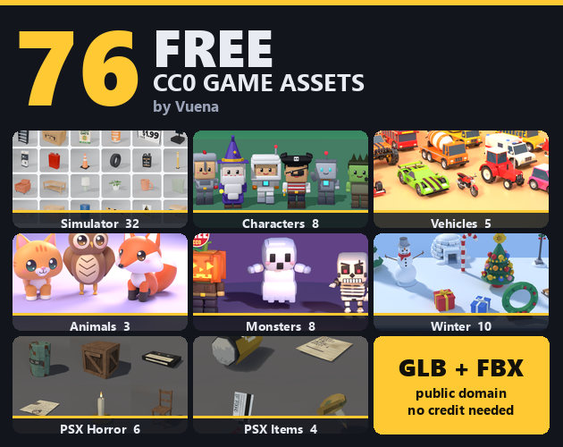
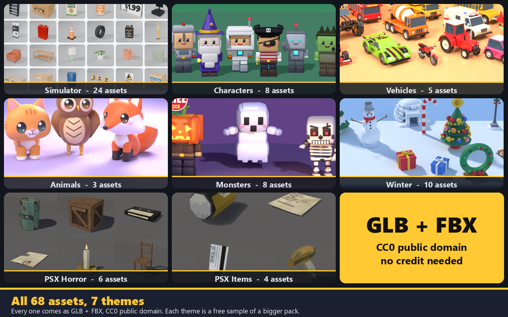
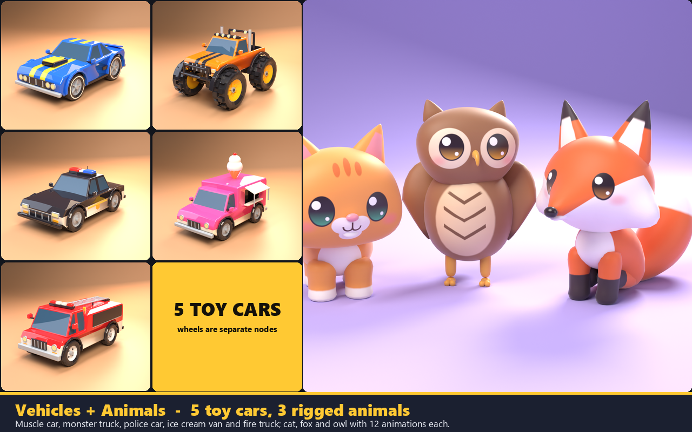
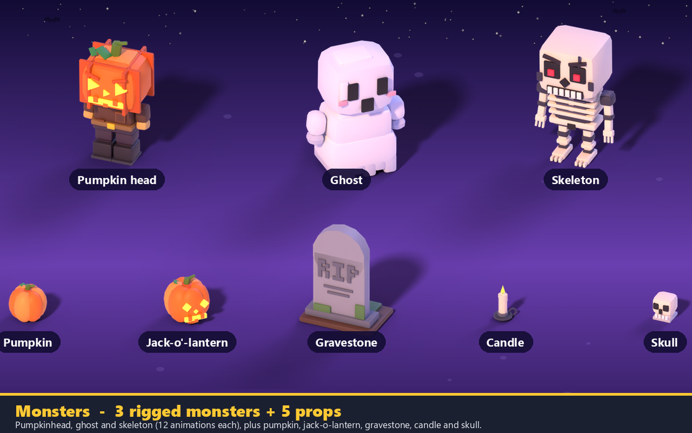
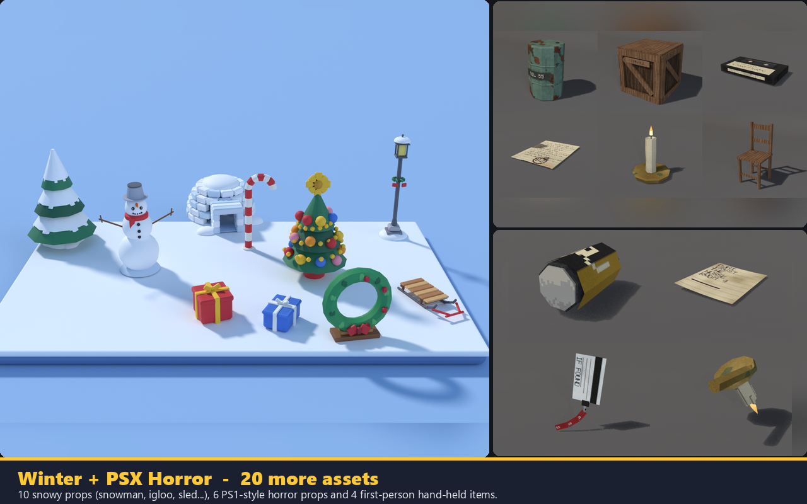
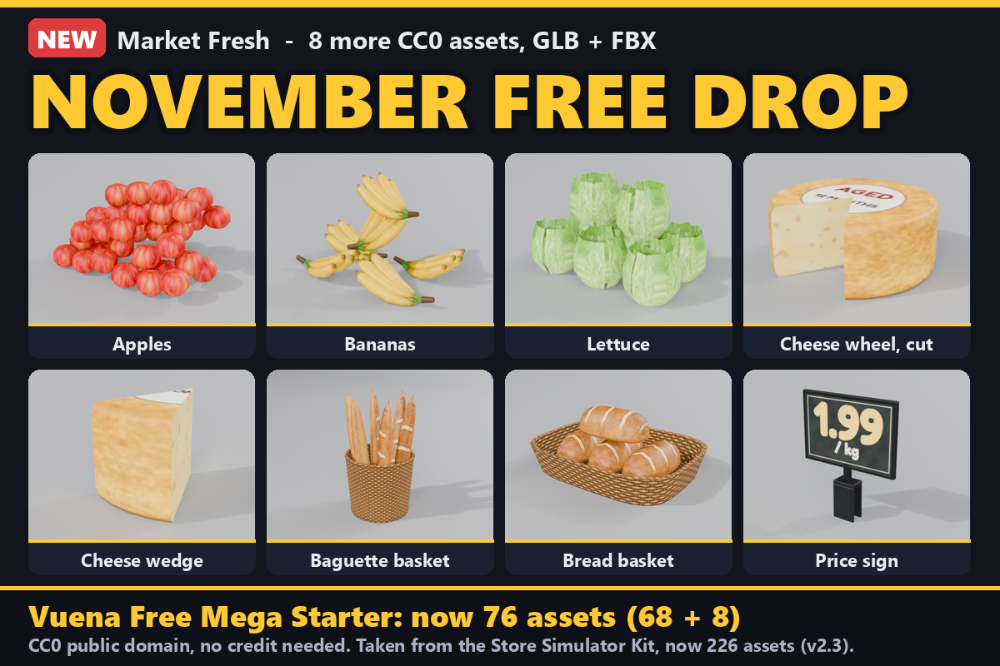

# Free CC0 Game Assets: the Vuena Mega Starter (76 models, GLB)

76 free game assets in blocky low-poly, PSX / PS1 and realistic PBR styles, all CC0 (public domain): simulator props, rigged characters, toy cars, animals, monsters, winter props and PSX horror props. GLB files that drop straight into Godot, Unity, Unreal Engine, Blender and three.js. No credit needed, commercial use is fine.

I put this starter together so you can try my work properly before spending anything. It collects the free samples of eleven of my packs into one repo. Every asset is a taste of a bigger pack, with one folder per theme.

## What is inside

**The main set: 68 GLB files** (14 of them rigged and animated, the rest are static props). All GLB files are self-contained: textures and animations are embedded.

| Folder | Assets | What |
| --- | --- | --- |
| `Simulator/` | 24 | 6 each from my four realistic PBR simulator kits (Store, Gas Station, Modular Apartment Interior, Factory) |
| `Characters/` | 8 | hero, knight, wizard, pirate, astronaut, robot, zombie, princess: rigged, 10 animations each |
| `Vehicles/` | 5 | toy cars with separate wheels: muscle car, monster truck, police car, ice cream van, fire truck |
| `Animals/` | 3 | cat, fox, owl: rigged, 12 animations each, with a mobile LOD in every file |
| `Monsters/` | 8 | pumpkinhead, ghost, skeleton (rigged, 12 animations each) plus pumpkin, jack-o-lantern, gravestone, candle, skull |
| `Winter/` | 10 | snowman, decorated tree, snowy pine, igloo, sled, candy cane, lantern post, wreath, two presents |
| `PSX-Horror/` | 10 | six PS1-style props (barrel, wooden crate, VHS tape, paper note, candle, chair) and four first-person hand-held items (battery, keycard, note, candle) |

`ASSET-LIST.txt` lists every single asset with the pack it comes from, its triangle count and its size.

**The November 2026 free drop: 8 more assets** in `November-Drop-Market-Fresh/`, as 8 GLB + 8 FBX + 6 textures: apples, bananas and lettuce as ready-made crate fills, a cut cheese wheel and a cheese wedge, a baguette basket, a bread basket and a chalk-style price sign. They come straight from the 2.2 update of my Store Simulator Kit and are not changed. That brings the Mega Starter to 76 assets.

| | |
| --- | --- |
|  |  |
|  |  |

## Using them

- **Godot 4, Blender, three.js, Babylon.js:** use the `.glb` files directly.
- **Unity and Unreal Engine:** import the `.glb` with a glTF importer, or grab the FBX edition (`GLB + FBX`, about 25 MB) from the [itch.io page](https://vuena.itch.io/vuena-free-mega-starter), which has the same 68 assets plus FBX files and their texture folders.
- The packs were made in different styles (realistic PBR simulator props, blocky characters, toy cars, PS1-style horror props), so check the sizes in `ASSET-LIST.txt` when you mix them and scale each pack to suit your scene.

## Good to know

- I did not change any model for this starter: they are the same files as in the individual free samples, merged into one repo with one folder per theme.
- I checked all 68 main GLB files with the Khronos glTF Validator: 0 errors. I have not tested the FBX files in Unity or Unreal myself.
- The lights, floors and backdrops in the pictures are not in the files.

## Licence

**CC0 1.0 Universal (public domain).** Use everything here in any project, commercial or not, with no credit and no need to ask me (`LICENSE`, plus `LICENSE.txt` as shipped in the itch.io zip). The only third-party files are the oak and walnut wood textures used in the `Simulator/Modular-Apartment-Interior-Kit` models, from Poly Haven [oak_veneer_01](https://polyhaven.com/a/oak_veneer_01) by Jenelle van Heerden, which are CC0 as well. The waiver covers only the files in this repo. The full packs are separate products with their own licences.

## How they were made, honestly

The models and textures were made with my own procedural Blender code, which I wrote with AI help. The meshes and textures themselves are not AI-generated.

## If you like them, here are the full packs

Every asset here is a taste of a bigger pack:

- [Store Simulator Kit](https://vuena.itch.io/store-simulator-kit): realistic PBR shop assets
- [Gas Station Simulator Kit](https://vuena.itch.io/gas-station-simulator-kit)
- [Modular Apartment Interior Kit](https://vuena.itch.io/modular-apartment-interior-kit): 153 models
- [Factory Simulator Kit](https://vuena.itch.io/factory-simulator-kit)
- [48 Rigged Characters + 30 Animations](https://vuena.itch.io/blocky-characters-48)
- [50 Low-Poly Toy Cars](https://vuena.itch.io/toy-cars-20)
- [Cute Pets & Wildlife](https://vuena.itch.io/blocky-pets-wildlife): 36 rigged animals, 13 animations, 6 rideable mounts
- [Blocky Monsters](https://vuena.itch.io/blocky-halloween)
- [Blocky Winter & Christmas](https://vuena.itch.io/blocky-winter-christmas)
- [PSX Retro Horror Props Kit](https://vuena.itch.io/psx-retro-horror-props-kit)
- [PSX First-Person Arms & Items Kit](https://vuena.itch.io/psx-first-person-arms-kit)
- [PSX Night Shift Store Kit](https://vuena.itch.io/psx-night-shift-store-kit)

Want several at once? The **[Vuena All-in-1](https://vuena.itch.io/complete-collection)** has every pack plus all future packs in one purchase. Buying a pack is what keeps me making these, and everything in this repo stays free either way.

- Mega Starter on itch (grows with a new free drop every month): https://vuena.itch.io/vuena-free-mega-starter
- Browse every model: https://models.popyca.com
- All packs: https://vuena.itch.io
